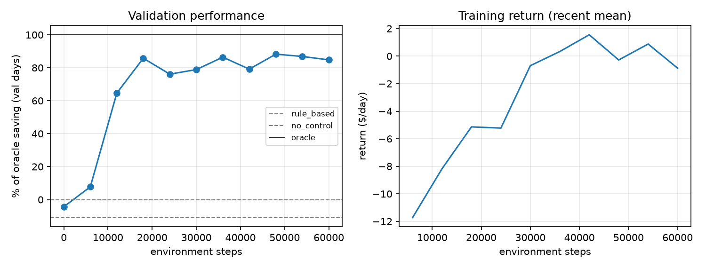
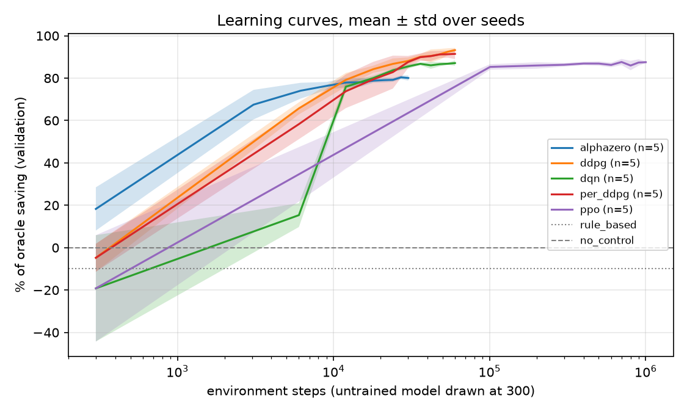
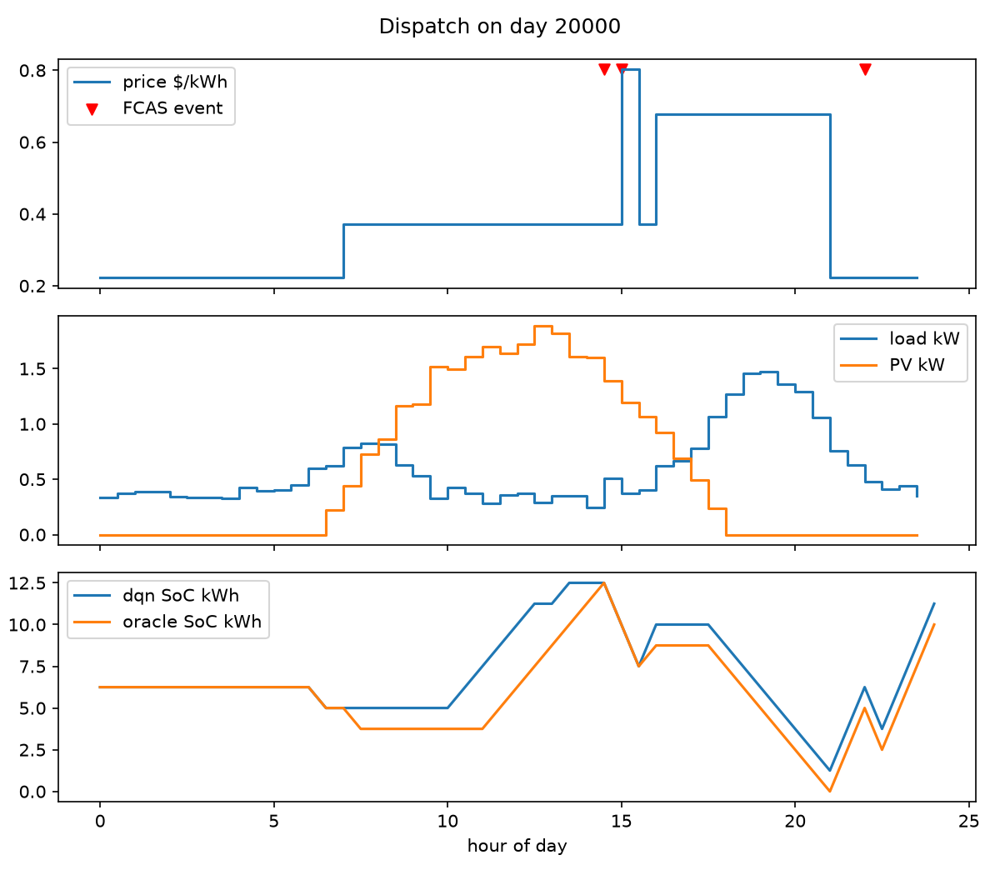
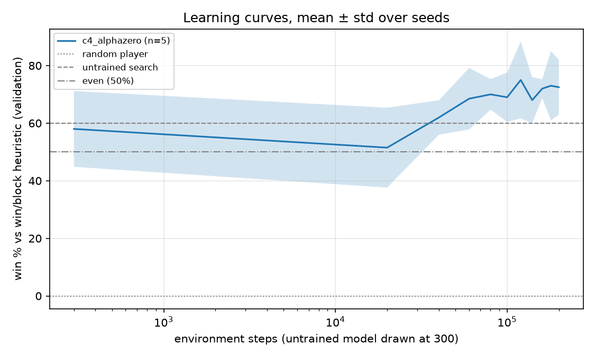
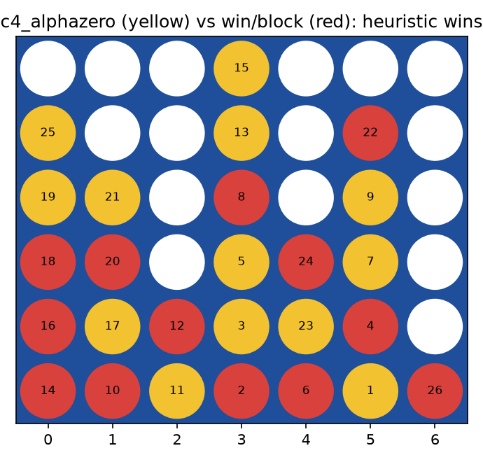
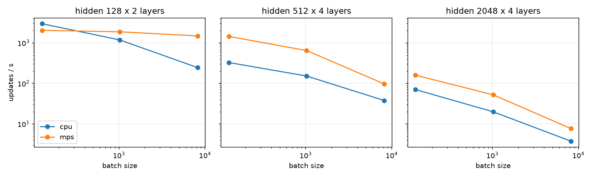

# drl-demand-response-demo

I built this in a week to show how I run RL experiments: how I train, how I measure whether something got
better, and how someone else can re-run my numbers and get the same ones.

There are two tasks on one harness. The first is a home battery that buys and sells electricity on a
time-of-use tariff and gets paid for discharging during FCAS-style frequency events; five agents (DQN, PPO,
DDPG, PER-DDPG and an AlphaZero-style search agent) are scored against the exact optimum. The second is Connect
Four, where the same search agent trains from random weights by playing itself.

Every run gets a fingerprint of its config, code, data, libraries and platform. Every run is logged to MLflow
with its plots. Any recorded run can be re-trained and compared with one command, and a run you kill and resume
ends with the same numbers as one you never killed. The tests check all of this.

What it is not: it is not my published research, and the Connect Four agent is not a strong player. It is a
small MLP with 50 search simulations and about 8000 games of training. It does improve, measurably, from random
weights, and the harness separates what the network learned from what tree search gives you for free. The
battery task is a simplified stand-in for the energy work in my papers, with synthetic data. Nothing here comes
from an employer, a client or a research partner.

## Contents
1. [The two tasks](#1-the-two-tasks)
2. [The agents](#2-the-agents)
3. [Install](#3-install)
4. [Commands](#4-commands)
5. [Where the runs go](#5-where-the-runs-go)
6. [Configs](#6-configs)
7. [How reproducibility works, and where it stops](#7-how-reproducibility-works-and-where-it-stops)
8. [How I measure, in pictures](#8-how-i-measure-in-pictures)
9. [Results: battery](#9-results-battery)
10. [Results: Connect Four](#10-results-connect-four)
11. [GPU](#11-gpu)
12. [Layout](#12-layout)
13. [Known limits](#13-known-limits)

## 1. The two tasks

### Battery dispatch (`task: dr`)

One episode is one day in 48 half-hour steps. The battery holds 12.5 kWh.

| | |
|---|---|
| Observation, 147 numbers | state of charge, time of day as sin/cos, then the rest of the day's prices, event flags and net load (load minus solar), zero-padded |
| Action | five levels from full charge to full discharge; DDPG uses one float in [-1, 1] instead |
| Reward | minus the energy bill, plus the FCAS bonus for discharging during an event, minus a degradation cost; what is left in the battery at midnight is valued at the day's mean price |
| Data | load, solar, price spikes and events are generated from the day number: days 0-199 for training, 5000+ for validation, 20000+ for test |

The agent sees the whole remaining day. That was a deliberate change from my first version, where agents saw six
steps ahead while the search agent could clone the environment and peek at everything. Now every agent plans from
the same information, and the dynamic-programming optimum is something a policy could reach, not a clairvoyant
bound.

Scores are percent of the oracle's saving over leaving the battery idle: 0 is idle, 100 is optimal. The oracle
runs on a grid ten times finer than the five actions, so it also bounds DDPG's continuous policy. The exact
optimum on the five-action grid, `oracle_discrete`, is 91.2% of that on the test days, so that is the ceiling for
DQN, PPO and the search agent.

### Connect Four (`task: connect4`)

Standard 6x7 board. The observation is two planes, my pieces and theirs, from the point of view of whoever is
about to move, so one network plays both colours.

Scoring a self-play agent is the part I spent the most thought on. Every evaluation plays a fixed set of random
two-ply openings, each once as first player and once as second, against three opponents: a random player, a
heuristic that takes an immediate win or blocks an immediate threat and otherwise plays randomly, and the agent's
own weights from the previous evaluation. It also plays the raw network with no search at all. The last two are
what tell you whether training did anything. Search with 50 simulations finds wins and blocks on its own, so a
win rate against the heuristic by itself proves little.

## 2. The agents

| config | file | what it is | task |
|---|---|---|---|
| `dqn` | `agents/dqn.py` | double DQN, target network, uniform replay | battery |
| `ppo` | `agents/ppo.py` | clipped-surrogate PPO with GAE, 8 parallel envs | battery |
| `ddpg` | `agents/ddpg.py` | DDPG with soft target updates and Gaussian exploration noise | battery |
| `per_ddpg` | `agents/ddpg.py` | the same with proportional prioritised replay (sum tree, annealed importance weights) | battery |
| `alphazero` | `agents/alphazero.py` | PUCT search guided by a policy/value net, trained on its own visit counts and returns | battery |
| `c4_alphazero` | `agents/alphazero.py` | the same agent in two-player mode: values flip sign each ply, moves are sampled for 8 plies then greedy, batches are mirrored left-right | Connect Four |

On the battery task the search agent's "opponent" is the day itself and the environment is the model, so that
one is planning, not self-play, and there is no learned dynamics model as in MuZero.

## 3. Install

Python 3.12 is what I recorded everything with; 3.10+ should work.

```bash
make setup     # venv, pinned dependencies, editable install of the `dr` package
make test      # about 40 s on a laptop
```

Without make: `python -m venv .venv && .venv/bin/pip install -r requirements.txt && .venv/bin/pip install -e .`

Docker: `docker build -t drl-dr . && docker run --rm drl-dr` runs the smoke test. The image is `python:3.12-slim`
plus the pinned requirements. On an x86_64 Linux host the torch wheel from PyPI includes CUDA, so
`docker run --gpus all drl-dr python scripts/train.py --config configs/dqn.yaml --device cuda` trains on the GPU.
On my arm64 Mac the same build is CPU-only, and the test suite passes inside it.

## 4. Commands

| command | does | time on my M4 Pro |
|---|---|---|
| `make test` | the test suite; the bitwise golden comparison only gates on the platform the goldens were recorded on | ~40 s |
| `make reproduce` | smoke run of every algorithm on both tasks, one seed, tiny budgets, into `results/quick/` | ~2 min |
| `make sweep` | battery task, 5 algorithms x 5 seeds, writes `results/summary.md` and the plots | ~6 min, 6 jobs |
| `make sweep-c4` | Connect Four, 5 seeds x 200k plies, into `results/connect4/` | ~10 min, 5 jobs |
| `make verify RUN=results/dqn/seed1` | re-train a recorded run and check it matches | ~1 min for DQN |
| `make bench` | learner throughput, CPU vs GPU; `PROFILE=1` adds a `torch.profiler` trace | ~1 min |
| `make golden` | re-record `tests/golden.json` after a change that is meant to alter results | ~20 s |
| `make ui` | MLflow at http://127.0.0.1:5000 | |

One run, with overrides, an interruption and a resume:

```bash
python scripts/train.py --config configs/dqn.yaml --seed 0
python scripts/train.py --config configs/ppo.yaml --seed 3 --device cuda --set algo.lr=1e-3 train.total_steps=500000
python scripts/train.py --config configs/connect4_alphazero.yaml --seed 0 --stop-at 100000   # checkpoint, then exit
python scripts/train.py --config configs/connect4_alphazero.yaml --seed 0 --resume           # same result as uninterrupted
```

A finished run whose fingerprint still matches is skipped, so if a sweep dies halfway you just start it again.
Runs print their curve as they go. The first line is the untrained policy:

```
[dqn s0] steps=      0 train=    nan val % of oracle saving=  -8.0 0s
[dqn s0] steps=  60000 train=   0.41 val % of oracle saving=  88.3 43s
```

## 5. Where the runs go

MLflow first. `make ui`, experiment `drl-demand-response`. One run per config and seed, named
`<variant>-seed<k>-<fingerprint prefix>`. Params are the whole config. Tags are the fingerprint parts plus the
git commit and whether the tree was dirty. Metrics are logged at every evaluation step, so the curves are live.
Artifacts are `config.yaml`, `meta.json`, `metrics.jsonl`, `final.json`, the training curve, and a task plot:
the battery schedule against the oracle for one test day, or one Connect Four game against the heuristic. Each
sweep also logs a `summary:<dir>` run with the table and the comparison plot, and `make bench` logs a `bench`
run. The store is `./mlflow.db`; set `MLFLOW_TRACKING_URI` for a shared server, or `--set tracker=none` to turn
tracking off. The store keeps everything ever logged, including runs from before I fixed things, so filter by
`tags.fingerprint` when you want the current ones.

On disk, each run is `results/<variant>/seed<k>/`:

```
config.yaml     the resolved config            metrics.jsonl   one row per evaluation, untrained row first
meta.json       fingerprint parts, git SHA, dirty flag, python, host, GPU, start time
final.json      test metrics plus the fingerprint
final.pt        network weights only, loads with weights_only=True
ckpt.pt         full training state, git-ignored          plots/   mlflow_run_id
```

Sweep-level files are `results/summary.md`, `results/learning_curves.png` and `results/baselines.json`, and the
same under `results/connect4/`. `python scripts/evaluate.py --run results/dqn/seed0` re-scores a run and redraws
its plots. The figure code is in `src/dr/plotting.py`.

## 6. Configs

One YAML file per experiment. Battery configs `extends: base.yaml`, later keys win, and `--set a.b=value`
overrides anything from the command line (`1e-3` is a float; PyYAML on its own would read it as a string, which
bit me once).

```yaml
extends: ddpg.yaml           # configs/per_ddpg.yaml, whole file
name: per_ddpg
algo: {per: true, per_alpha: 0.6, per_beta_start: 0.4}
```

Shared keys: `task`, `seed`, `device` (`auto` picks CUDA if present), `tracker`, `env`, `train`
(`total_steps`, `n_train_days`) and `eval` (`every_steps`, then `val_days`/`test_days` or
`val_games`/`test_games`). `name` is the output folder and the MLflow label. Names in one sweep must be unique,
and everything in one results directory must share task, env and eval settings, otherwise the report refuses to
build a table rather than build a misleading one.

## 7. How reproducibility works, and where it stops

Each run's identity is a 12-character hash of five parts:

| part | what goes in |
|---|---|
| `config_hash` | the resolved config, seed included; `tracker` and `experiment` excluded because they cannot change results |
| `code_hash` | every Python file under `src/dr`; `scripts/` is excluded because it only launches and reports |
| `data_hash` | every generated day a battery run can touch, or the game plus the opening seeds for Connect Four |
| `libs`, `platform`, `device` | torch, numpy and Python versions; OS and CPU architecture; cpu or cuda |

The fingerprint is in `meta.json`, `final.json` and the MLflow tags. Change any input and it changes, so a number
can always be traced to exactly what produced it, and a finished run is only skipped when nothing has changed.
With real data, a dataset checksum would go into `data_hash`.

Determinism on one machine is exact. Python, numpy and torch are seeded, each agent owns its own numpy generator
and PPO its own torch generator, and torch runs one CPU thread with deterministic kernels requested. Checkpoints
hold every random-number stream (numpy, torch, CUDA, PPO's), the replay buffers (the prioritised buffer saves
its sum tree as built, so the float sums come out in the same order), the live environments, and the previous
evaluation's weights. That last one matters: an earlier version stored a `state_dict()` directly, which aliases
the live parameters, so the "previous checkpoint" the Connect Four agent was scored against was silently its
current self. The resume test caught it. The suite now asserts, for all six configurations, that stopping at 750
steps and resuming gives the same metrics as never stopping.

Check it yourself:

```bash
make verify RUN=results/dqn/seed1
# fingerprint MATCH | learning curve MATCH | test return 1.779184 vs 1.779184 MATCH
```

`verify` re-trains from the saved config in a temporary folder and compares the fingerprint, every row of the
learning curve and the test result. It exits non-zero on a mismatch and says which fingerprint part moved. On a
different machine use `scripts/verify.py --run ... --tol 1e-3`; the fingerprint will differ and so may the last
bits.

Across platforms I measured rather than assumed. `tests/golden.json` holds results of 1500-step runs recorded on
macOS arm64. On that platform the tests require bitwise agreement. Inside a Linux container on the same CPU, PPO,
PER-DDPG and both search agents came out bitwise identical to macOS; DQN was off by 1.4% in mean return and DDPG
by 0.09%. A different BLAS build rounds some reductions differently, and 1500 steps of training amplify the last
bit. So: exact on one platform, statistically the same across platforms. Off the recording platform the golden
tests still run, but as informational tests that may fail. GitHub Actions runs the suite on Linux x86_64 on every
push and shows the same comparison.

Train, validation and test days or openings never overlap. I tuned hyperparameters with one seed on validation
days and on test days 10000-10019; the test days in the tables (20000+) were not used for any decision. For
Connect Four I chose the temperature schedule, the augmentation and the budget from single-seed runs on the
validation openings; the test openings were used once, for the table.

Not done yet: CUDA. Deterministic mode is requested but I have not run on a GPU here. `make bench` and
`make verify --tol` on a GPU box are the first things I would do there.

## 8. How I measure, in pictures

Every figure below is produced by the code in this repo from the runs committed under `results/`, and each one
is also attached to its MLflow run. These are the plots I look at before I believe a number.

### One run: did it learn, and when?



`results/<variant>/seed<k>/plots/training_curve.png`. Left: the validation score at every evaluation, on ten
days the agent never trains on, with the rule-based heuristic and the idle battery as dashed lines. The first
point is the untrained network, so the "before" is always on the chart. Right: the mean return of the last 20
training episodes. If the right side climbs and the left side does not, the agent is fitting its training days
and I do not trust it.

### All runs: is it the algorithm or the seed?



`results/learning_curves.png`. One line per algorithm, mean over five seeds, shaded band one sample standard
deviation, log scale on steps. This is the plot that stopped me reporting PPO at 75% from one seed; the band
told me the spread was 14 points, and the fix (every agent sees the whole day) brought it to 87 ± 0.8. Lines
that cross the dotted heuristic early and bands that narrow as training goes on are what I want to see. The
x-axis is environment steps, so the search agent's 64 simulations per step are not counted; the curves are not
matched compute.

### The policy itself: what does it do all day?



`results/<variant>/seed<k>/plots/dispatch_day<N>.png`. Top: the price, with red markers on the FCAS events.
Middle: household load and solar. Bottom: state of charge over the day for the trained policy and for the
dynamic-programming oracle. A good policy charges before the price spikes and the evening peak, discharges into
them and into the events, and ends the day where it started. When the two curves part ways I can point at the
half hour where the policy left money on the table. A table of percentages does not tell me that.

### Connect Four: is the network learning, or is the search carrying it?



`results/connect4/learning_curves.png`. Win rate against the win-or-block heuristic on 20 held-out openings,
played as both colours, mean and spread over five seeds. The dashed line is the same search with an untrained
network, which already wins about 58% because 50 simulations find immediate wins and blocks by themselves. The
curve has to clear that line, not the 50% line, before training gets any credit. In the per-run metrics there
are two more columns I watch: `val_winrate_prev`, the current weights against the previous evaluation's weights
(above 50 means the last 20k plies helped), and `val_raw_winrate_winblock`, the network with no search at all,
which starts at 0 and ends near 46.



`results/connect4/c4_alphazero/seed0/plots/sample_game.png`. One test game, agent in yellow, heuristic in red,
move numbers on the discs. I keep this because a win rate hides how a game was lost; here the heuristic won, and
you can trace which move let it.

### Hardware: when does a GPU pay for itself?



`results/bench.png`, from `make bench`. Updates per second against batch size, one panel per network size, one
line per device. For the small networks these agents use, the CPU wins at batch 128 and the accelerator only
pulls ahead at large batches or deeper networks. I measure this before I claim a speedup, and I will re-run it on
a CUDA machine before saying anything about CUDA.

## 9. Results: battery

Five seeds, 50 held-out test days, one CPU core per run on an Apple M4 Pro, mean ± sample standard deviation.
This table is what `make sweep` produced at this commit, and `make verify` on any of those runs reproduces it.

| method | test saving $/day | % of oracle saving | env steps | train wall (s) |
|---|---|---|---|---|
| no_control | 0.00 | 0.0 | - | - |
| random | -5.72 | -59.5 | - | - |
| rule_based | 0.34 | 3.6 | - | - |
| oracle_discrete (5-action ceiling) | 8.78 | 91.2 | - | - |
| alphazero | 7.91 ± 0.13 | 82.2 ± 1.3 | 30k | 102 |
| ddpg | 9.08 ± 0.04 | 94.3 ± 0.4 | 60k | 93 |
| dqn | 8.49 ± 0.08 | 88.2 ± 0.8 | 60k | 52 |
| per_ddpg | 8.87 ± 0.18 | 92.2 ± 1.9 | 60k | 120 |
| ppo | 8.37 ± 0.08 | 87.0 ± 0.8 | 1M | 68 |

DQN gets 88.2 of the 91.2 points a five-action policy can get. DDPG's continuous action takes it past that
ceiling to 94.3. Prioritised replay did not help here and costs more time. PPO lands near DQN but needs about
17 times the samples. The search agent starts well above zero before any training, because planning with the
exact model already works, and training takes it to 82; its step count ignores the 64 simulations per step. The
budgets and evaluation cadences differ per algorithm, so the curves in `results/learning_curves.png` are not
matched-compute comparisons.

## 10. Results: Connect Four

Five seeds. 100 held-out openings, each played as both colours, so 200 games per opponent. 200k self-play plies
per seed, about 8000 games, 560 s each on one core. From `make sweep-c4` at this commit.

| method | win % vs random | win % vs win/block | loss % vs win/block | network only, no search: win % vs win/block |
|---|---|---|---|---|
| random | 48.5 | 3.5 | 96.5 | - |
| winblock (against itself) | 95.0 | 47.0 | 50.0 | - |
| untrained search, 50 sims | 95.0 | 49.5 | 48.0 | 0.0 |
| c4_alphazero, 5 seeds | 96.3 ± 0.8 | 68.5 ± 4.3 | 26.0 ± 3.7 | 45.8 ± 4.6 |

Same search budget before and after training: wins against the heuristic went from 49.5% to 68.5%, losses from
48% to 26%. The raw network with no search went from losing every game to winning 46%, which is the line that
says the network learned to play rather than the search doing the work. During training the agent beat its
previous checkpoint in most evaluations (`val_winrate_prev` in each seed's `metrics.jsonl`). Validation win rate
against the heuristic goes from about 58% to 72% over the run and does nothing for the first 20k plies
(`results/connect4/learning_curves.png`).

For scale: untrained search with 200 simulations already wins 79% and loses 16%. At this size, more search is
still the cheaper way to get stronger. What this shows is a self-play loop that works and is measured properly.

## 11. GPU

The networks are small and both the environment stepping and the tree search are Python on the CPU, so at these
sizes a GPU does not make training faster. `make bench` measures learner-update throughput across network and
batch sizes and logs the plot. Speedup of the accelerator over one CPU thread on my laptop (Apple M4 Pro, MPS;
CUDA not measured yet):

| network | batch 128 | batch 1024 | batch 8192 |
|---|---|---|---|
| 128 wide x 2 layers | 0.7x | 1.6x | 6.0x |
| 512 wide x 4 layers | 4.4x | 4.2x | 2.6x |
| 2048 wide x 4 layers | 2.3x | 2.6x | 2.0x |

On a CUDA machine, `make bench` (with `PROFILE=1` for a profiler trace) and `--device cuda` for training. Replay
sampling, networks and updates move to the device; environments and search stay on the CPU.

## 12. Layout

```
configs/            base.yaml, dqn, ppo, ddpg, per_ddpg, alphazero (battery); connect4_alphazero
src/dr/
  env.py              battery env, day generator, vectorised DP oracle and oracle policy
  games/connect4.py   Connect Four env, scripted opponents, fixed-opening games
  tasks/              dr.py, connect4.py: env factory, evaluation protocol, baselines, data hash, plots
  agents/             common.py (BaseAgent, MLP, replay buffers, sum tree), dqn, ppo, ddpg, alphazero
  runner.py           one experiment: run dir, eval loop, checkpoints, stop/resume, test, plots
  fingerprint.py      config + code + data + libs + platform hash
  tracking.py         MLflow wrapper, no-op when off          plotting.py   figures
  config.py           YAML loading, extends, overrides, hash   evaluate.py   battery splits and baselines
scripts/            train, sweep, report, evaluate, verify, bench, golden
tests/              determinism, resume, fingerprint, replay, config, Connect Four rules, golden values
.github/workflows/  CI on Linux        Makefile  Dockerfile  pyproject.toml  requirements.txt
```

## 13. Known limits

The battery task has perfect day-ahead information. The real problem has forecast error, and neither the oracle
nor the agents face it here.

The Connect Four agent is weak in absolute terms. With 40 validation games a single seed's win rate moves by
about eight points between evaluations, which is why I report five seeds with sample standard deviation.

`code_hash` covers everything under `src/dr`, including the plotting code, so a plot-only change marks recorded
runs as stale even though it cannot change a result. I chose caution over precision there.

No CUDA numbers yet. Bitwise agreement holds on one platform; across OS or BLAS builds, two of six agents differ
in the last bit and training amplifies it.

The MLflow store still has superseded runs from while I was building this.
